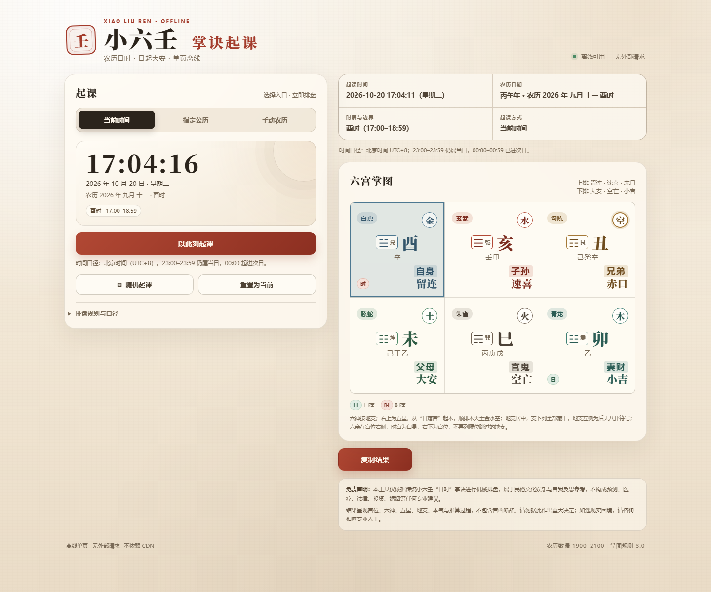

# 六宫掌图 · 小六壬 / 梅花易数

一个纯前端、离线可用的传统术数排盘小工具，包含：

- **小六壬**：农历日时起课，六宫掌图、六神、五星、六亲、藏干、后天八卦。
- **梅花易数**：按小时、分钟起卦，主卦 / 互卦 / 变卦，动爻、卦宫、时间旬空。
- **Web 单页**：无后端、无 CDN，直接打开即可使用。
- **微信小程序**：原生 WXML/WXSS/JS，可导入微信开发者工具。

> 本项目只做机械排盘和传统文化展示，不包含吉凶断辞，不构成预测、医疗、法律、投资等专业建议。

## 截图




## 功能

### 小六壬

- 当前时间、指定公历、手动农历、随机起课
- 农历闰月、大小月、三十日、子时边界校验
- 六宫顺序：大安 → 留连 → 速喜 → 赤口 → 小吉 → 空亡
- 日起大安，按农历日顺数；日上起时
- 日 / 时落宫标记
- 五星从日落宫起木，顺排木、火、土、金、水、空
- 六神、六亲、地支藏干、后天八卦
- 掌图双指缩放、双击放大、拖动、复位

### 梅花易数

- 只取小时和分钟，忽略年月日
- 上卦：小时数 ÷ 8 取余，余 0 作 8
- 下卦：分钟数 ÷ 8 取余，余 0 作 8
- 动爻：小时数 + 分钟数，÷ 6 取余，余 0 作 6
- 主卦、互卦、变卦三列大图
- 六爻按上下卦五行配色，动爻标记
- 八宫归属、卦宫、时间旬空（四柱）
- “所问之事”可填写，并随结果复制
- 时间旬空按四柱显示：干支与旬空分列，四柱横排、柱内竖读

## 项目结构

```text
liugong-zhangtu/
├─ LICENSE
├─ README.md
├─ .gitignore
├─ miniprogram/              # 微信小程序
│  ├─ app.js
│  ├─ app.json
│  ├─ app.wxss
│  ├─ project.config.json
│  ├─ sitemap.json
│  ├─ pages/index/           # 小六壬
│  ├─ pages/meihua/          # 梅花易数
│  └─ utils/
│     ├─ xiaoliuren.js
│     └─ meihua.js
├─ web/
│  └─ index.html             # 离线 Web 单页
├─ tests/
│  ├─ core.test.mjs          # 小六壬核心测试
│  └─ meihua.test.mjs        # 梅花易数核心测试
└─ docs/
   └─ screenshots/
```

## 快速开始

### Web

直接用浏览器打开：

```text
web/index.html
```

不需要安装依赖，不需要服务器。

### 微信小程序

1. 打开微信开发者工具。
2. 导入项目，目录选择 `miniprogram/`。
3. `project.config.json` 里的 AppID 是 `touristappid`，请替换为你自己的小程序 AppID。
4. 导入后编译。

只给朋友用：上传后到微信公众平台把版本设为体验版，并添加体验成员。正式公开发布仍需遵守微信平台规则。

## 测试

需要 Node.js 18+。

```bash
npm test

# 或分开运行
node tests/core.test.mjs
node tests/meihua.test.mjs
```

当前：

- 小六壬核心测试 23 项
- 梅花易数核心测试 7 项

## 规则说明

### 小六壬

- 六宫：大安、留连、速喜、赤口、小吉、空亡
- 日：大安起初一，顺数至农历日
- 时：日宫起子时，顺数至时辰
- 闰月不参与起宫
- 子时：23:00–00:59；00:00 为换日界
- 时间统一为北京时间 UTC+8

### 梅花易数

- 年月日不参与起卦，只用小时和分钟
- 先天八卦数：乾 1、兑 2、离 3、震 4、巽 5、坎 6、艮 7、坤 8
- 互卦：主卦二、三、四爻为下卦，三、四、五爻为上卦
- 变卦：主卦动爻阴阳变化所得
- 时间旬空：年柱以立春为界，月柱按节气，日柱按儒略日，时柱按五鼠遁

## 隐私

- 无后端、无账号、无用户数据采集
- 无外部 CDN
- 小程序不请求网络接口
- “所问之事”只保存在当前页面内，退出页面即清空

## 许可证

本项目使用 [MIT License](LICENSE)。

小六壬、梅花易数属于传统民俗文化内容；代码与界面实现按 MIT 许可证开放。使用或再发布时请保留免责声明，不要将排盘结果包装成医疗、法律、投资等专业建议。

## 免责声明

本工具仅依据传统小六壬、梅花易数规则进行机械排盘，属于民俗文化娱乐与自我反思参考，不构成预测、医疗、法律、投资、婚姻等任何专业建议。请勿据此作出重大决定；如遇现实困境，请咨询相应专业人士。

本项目与微信、腾讯无隶属关系。
